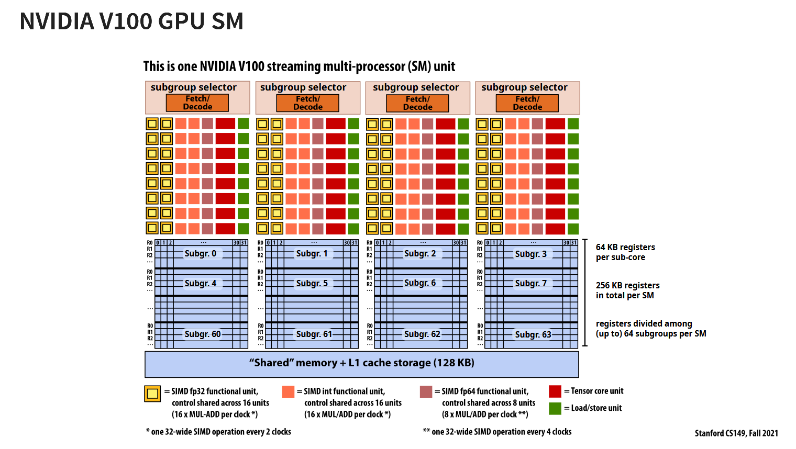

# GPU support

To use GPU accelerated sat solving, the mallob gpu api (MGI) needs to be enabled.

## Prerequisits

> [!WARNING]  
> Currently MGI only supports **OpenCL 3.0** as backend

The usage of `clang` and the respective packages for `llvm-spirv` are highly recommanded and are default enabled.
`clang++`, `llvm-spirv` and all required packages are assumed to be installed. 
If you want to disable OpenCL C to SPIR-V auto-compile use the appropriate flag in the flags section.

### NVIDIA

You need the newest [CUDA Toolkit](https://developer.nvidia.com/cuda-downloads) from NVIDIA

> [!NOTE]
> This is currently tested on *Fedora 43* and *Debian 13*

### AMD

TODO

> [!WARNING]  
> AMD Support is currently untested

### Intel

The Intel [Graphics Compute Runtime](https://github.com/intel/compute-runtime) is needed for OICDs.
Hardware support and installation instructions can be found on their Github page.

> [!WARNING]  
> Intel Support is currently untested

### WSL

TODO -> Try

## Usage

In order to compile mallob with GPU features the support must be enabled through CMake.

### Using presets

We provide a `CMakePresets.json` with GPU [configure presets](https://cmake.org/cmake/help/latest/manual/cmake-presets.7.html) for ease of use.
The `linux-debug-gpu` (Nativ Linux GPU Debug) preset is currently the main gpu preset.
You can either enable this your IDE/CMake Extension or manually use it in command line.
> cmake --preset linux-debug-gpu

### Manually

Otherwise the `MALLOB_USE_GPU` cmake flag can be set.

> cmake ./ -DMALLOB_USE_GPU=1

Additionally if you want more output consider using the `MALLOB_ASSERT` flag which enables debug output for the API layer.
Provided the `MALLOB_LOG_VERBOSITY` is set correctly (>=debug).

## Flags

|Flag|Usage|Default|
|-|-|-|
|`MALLOB_MGI_OCL_LAYERS`| Automatically download and add a compile target for the OpenCL validation layers. Needs environment configuration. This is automatically configured if the preset is used | On
|`MALLOB_MGI_TEST_COMPILE`| Enable clang OpenCL-C++ to SPIR-V compiler that automatically run to check your kernels for errors. | Off (On in preset)

## Development

## Defines

These defines can be used to check for features in the code C++ host code.

|Flag|Usage|
|-|-|
|`MGI_API_OCL`| Enabled if OpenCL is used as backend 
|`MALLOB_USE_GPU`| Enabled if MGI is enabled.


## Basics



### Memory types

`Allocation` type describes the allocation location and features of the memory. This is controlled by the host and is represented by the `MemoryType` enum. They control which device (Host or GPU) can read and write to the memory.
If both device have access at all time to the memory it highers the amount of overhead for each memory access. While memory with less access rights needs more time during host updates (with writeMemory, readMemory).

```cpp
    enum class MemoryType
    {
        Global,      // All read/write
        Uniform,     // Host read/write, Kernel read only
        DeviceLocal, // Kernel read/write only
        Constant     // Kernel read only
    };
```

This is not to be confused with `Device` memory types. Device memory types are used in the shaders and only control which memory in the device hirachie is used. Memory allocated by the host is always `MGI_GLOBAL` memory. The other types can be seen in the diagram. `MGI_LOCAL` are registers which can be seen in the subgroup space. `MGI_SHARED` is the shared memory that is shared between subgroups. They have increasingly less latency.

```cpp
    #define MGI_GLOBAL global 
    #define MGI_SHARED local 
    #define MGI_CONST const constant
    #define MGI_LOCAL private 
```

### Architecture


TODO -> From Notes